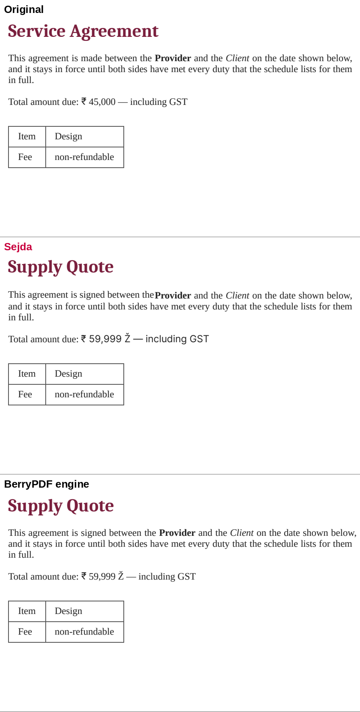

# F16 engine: same three edits, reference editor vs our engine

Run on 24 Nov 2026 at 02:11 UTC. This was one save on the reference product's free tier, within the 3-per-hour rule.
This is engine-level evidence for AC-11g. It is not the evaluator verdict for the editor, which still
needs the E1 UI.

**Input:** `tests/parity/editor/chrome-justified-mixed.pdf` (Chrome print, justified serif text with bold
and italic runs, and a ₹ amount).

**Edits:**
1. "Service Agreement" → "Supply Quote"
2. "made" → "signed"
3. "45,000" → "59,999 Ž"

Both tools got the same three edits. The reference output is the file downloaded after applying,
rendered with PDFium at 2x. Our output is `berry replace` from the CLI, the same engine code the
browser runs.

| Check | Reference | Ours |
|---|---|---|
| Space before a bold word on a justified line | Dropped: renders and extracts as "theProvider" | Kept: "the **Provider**" |
| Font of the edited amount line | The whole phrase switches from serif to a sans font it embeds (Inter) | Serif kept. Only the characters the font lacks use a same-family fallback |
| Text extraction order | Edited lines move to the end of the page's text | Reading order unchanged |
| Untouched text | Unchanged | Pixel-identical outside the reported change box (oracle) |

Result: on this file our engine wins all three edit-fidelity checks and ties on untouched text.
